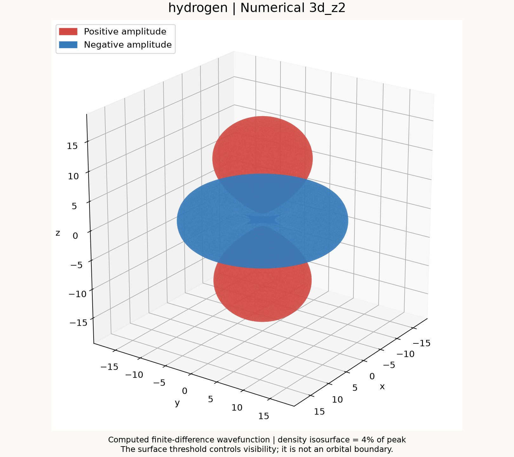

# 3D stationary Schrödinger solver

A finite-difference solver for `H psi = E psi`, with `hbar = mass = 1`.
Choose a preset or supply your own real potential, then plot numerical states.
The hydrogen orbital mode uses the same Cartesian Hamiltonian with symmetry
selection; analytical wavefunctions are not used to generate the plots.

## Start here

1. Double-click `setup.cmd` to install or update dependencies (Python 3.10+).
2. For general potentials, edit `config/settings.toml` and run `plot.cmd`.
3. For named hydrogen orbitals, edit `config/hydrogen.toml` and run `hydrogen.cmd`.
4. New images appear in `outputs/plots/`.

| What you want to change | File |
| --- | --- |
| Potential name, grid, generic energy index, plot style | `config/settings.toml` |
| Hydrogen orbital label such as `2p_z` or `3d_z2` | `config/hydrogen.toml` |
| Your own function `V(x, y, z)` | `custom/potential.py` |

Both launchers work when double-clicked; no command-line arguments are needed.
Relative custom output paths are resolved from the project root. An empty
`output` chooses an automatic filename in `outputs/plots/`.

## Folder layout

```text
.
├── plot.cmd / hydrogen.cmd / setup.cmd   # Windows launchers
├── config/                              # Settings you edit
├── custom/potential.py                  # Your potential function
├── schrodinger3d/                       # Solver and plotting code
├── examples/basic_usage.py              # Short complete calculation
├── tests/                               # Physical and display checks
├── docs/                                # Method, sources, limitations
└── outputs/                             # Local results; ignored by Git
    ├── plots/                           # New figures
    ├── checks/                          # Diagnostics and migration manifest
    └── archive/                         # Previous local plots and cache
```

`.venv` and any `.audit-venv` are ignored local Python environments, not source
folders. See [folder details](docs/folder-layout.md) for the module map.

## Understand the method

Read [examples/basic_usage.py](examples/basic_usage.py) first, then follow:

```text
potential function → spatial grid → sparse Hamiltonian → eigenstates
                  → symmetry selection (optional hydrogen mode) → figures
```

The [step-by-step method explanation](docs/numerical-method.md) covers the
finite-difference formula, octant symmetry, real p/d selection, normalization,
and what the figure colors and surfaces mean.

| Module | Responsibility |
| --- | --- |
| `schrodinger3d/potentials.py` | Named potential formulas and preset selection |
| `schrodinger3d/solver.py` | Grid, Hamiltonian, lowest eigenstates |
| `schrodinger3d/hydrogen.py` | Numerical s/p/d symmetry selection |
| `schrodinger3d/plotting.py` | Settings, CLI, central cuts, energy plots |
| `schrodinger3d/display.py` | Auto framing, central interpolation, 3D isosurfaces |

## Potentials

| Setting | Potential |
| --- | --- |
| `box` | Infinite cubic well |
| `paper_harmonic` | Paper's harmonic coefficient, 0.0001/2 |
| `circular` | Paper Appendix A's square-wave expression |
| `torus` | Paper's torus, R=0.4L and r=0.1L |
| `tanh` | Paper's tanh potential, independent of z |
| `hydrogen` | Coulomb potential, -1/r |
| `harmonic` | Separate omega=1 analytical benchmark |
| `custom` | Your function in `custom/potential.py` |

The [paper preset notes](docs/paper-potentials.md) give formulas, equation
locators, the circular-well source ambiguity, and the change in unit convention.
The paper presets do not automatically reproduce the original scaled spectra.
The full original scripts remain in the repository's `legacy` branch.

## Your own potential

Edit `custom/potential.py`, for example:

```python
def V(x, y, z):
    return 0.2 * (x**2 - 4)**2 + 0.5 * (y**2 + z**2)
```

Set `potential = "custom"` in `config/settings.toml`, save, and run `plot.cmd`.
Use NumPy operations such as `np.exp` and `np.where` on the coordinate arrays.
Return a real finite scalar or an array broadcastable to `(n, n, n)`.
The six cube faces still impose zero wavefunction. Do not multiply V by h squared.

## Higher states and hydrogen

In generic mode, `state = 4` selects the fifth energy-sorted state, counting
degeneracies. It is not a principal quantum number or an `(n,l,m)` label.
`states = 10` means compute at least ten states, not select state ten.

The named hydrogen mode in `config/hydrogen.toml` selects a numerical symmetry
sector with `hydrogen_orbital = "3d_z2"`. Other labels include `2p_z`, `3d_xy`,
and the low s/p/d states listed in the [hydrogen guide](docs/hydrogen-orbitals.md).
It overrides the generic energy-index choice.



The 3D surface marks density equal to 4% of its sampled peak; it is not a sharp
orbital boundary. Red and blue show amplitude signs. `zoom = "auto"` retains
at least 99.5% of sampled probability in the display, and `density_scale = "log"`
makes weak density lobes visible. These options do not modify the computed state.

## Commands, if preferred

Run these from the project root. The modules require no editable installation:

```powershell
python -m venv .venv
.\.venv\Scripts\python.exe -m pip install -r requirements.txt
.\.venv\Scripts\python.exe -B -m schrodinger3d.plotting
.\.venv\Scripts\python.exe -B -m schrodinger3d.plotting --config config/hydrogen.toml
.\.venv\Scripts\python.exe -B -m schrodinger3d.solver --potential box
.\.venv\Scripts\python.exe -B -m examples.basic_usage
.\.venv\Scripts\python.exe -B -m unittest discover -s tests -v
```

On macOS/Linux, create the environment with `python3 -m venv .venv` and use
`.venv/bin/python` instead of `.venv\Scripts\python.exe`.
Command-line options override settings for that run.

## Accuracy and scope

This is a stationary, single-particle, nonrelativistic solver. There is no time
evolution. A small eigenpair residual confirms the discrete matrix solution;
continuum accuracy still needs separate grid and box-size checks. Higher states
need enough spatial extent and resolution. Cubic symmetry-selected hydrogen
states approach their free-atom labels on convergence; their continuum angular
quantum numbers are not exact on a finite cubic grid.

Tests cover independent stencil comparisons, box spectra and convergence,
preset formulas, normalization, negative energy shifts, reconstruction under
the original full Hamiltonian, nodal planes, auto framing, and a hydrogen shape
reference used only for validation.

Related paper: [Solving 3D Time Independent Schrodinger Equation Using Numerical
Method](https://doi.org/10.13140/RG.2.2.13878.01602/1).
