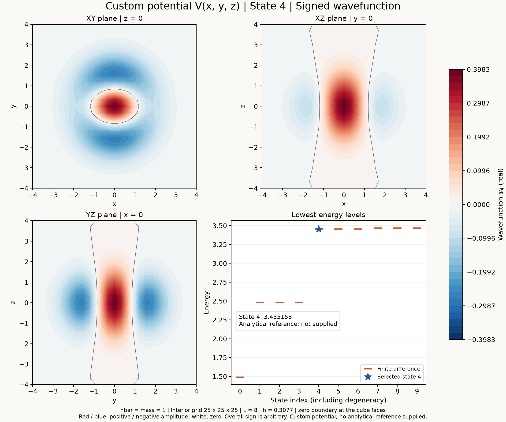

# 3D stationary Schrödinger solver

A Python solver for the stationary 3D Schrodinger equation using second-order
finite differences, sparse Kronecker sums, and `eigsh`. Define your own real
potential, select an energy state in a settings file, and plot its wavefunction
or probability density.

Related paper: [Solving 3D Time Independent Schrodinger Equation Using Numerical
Method](https://doi.org/10.13140/RG.2.2.13878.01602/1).

## Windows quick start

Requires Python 3.10 or later on PATH.

1. Double-click `setup.cmd` to create `.venv` and install or update dependencies.
2. Edit `custom_potential.py` to define `V(x, y, z)`.
3. Edit `settings.toml` to select the grid, state, and plot type.
4. Double-click `plot.cmd`. Open the generated image in `plots/`.



The screenshot uses the initial custom harmonic function, state 4, and a 25^3
grid. Custom functions do not get an assumed analytical reference curve.

## Run the solver

Alternatively, install and run from PowerShell:

```powershell
python -m venv .venv
.\.venv\Scripts\python.exe -m pip install -r requirements.txt
.\.venv\Scripts\python.exe schrodinger_3d.py --potential harmonic
.\.venv\Scripts\python.exe schrodinger_3d.py --potential box --n 24 --length 8 --states 6
.\.venv\Scripts\python.exe -m unittest discover -v
```

On macOS or Linux, use `.venv/bin/python` in place of `.venv\Scripts\python.exe`:

```bash
python3 -m venv .venv
.venv/bin/python -m pip install -r requirements.txt
.venv/bin/python plot_states.py
```

## Plot using the settings file

1. Edit and save `settings.toml`.
2. Double-click `plot.cmd`.
3. Open the generated image in `plots/`.

The current settings select state 4 of your custom potential and display its signed
wavefunction. The launcher uses the local `.venv` created by `setup.cmd`.
It keeps the console open so you can read the result or any error.

```toml
[simulation]
potential = "custom"
n = 25
length = 8.0
states = 10

[plot]
state = 4
quantity = "wavefunction"
output = ""
```

Every setting has an English comment in `settings.toml`. An empty `output`
selects an automatic filename. Relative output paths are resolved from the
settings file's directory, regardless of the working directory at launch.

You can also run the plotter without command-line arguments:

```powershell
.\.venv\Scripts\python.exe plot_states.py
```

Command-line options override individual settings for one run:

```powershell
.\.venv\Scripts\python.exe plot_states.py --potential harmonic --state 0 --quantity density
.\.venv\Scripts\python.exe plot_states.py --potential box --state 0 --quantity density
```

Use `--config another_settings.toml` to select a different settings file.
The settings file only controls `plot_states.py`; the standalone solver keeps
its own command-line options.

Each image shows the selected state's central XY, XZ, and YZ slices, plus
computed energies. Only `box` and the omega=1 `harmonic` benchmark show continuum
reference levels; other presets have no assumed analytical reference. All three slices share
one color scale. These are local slices, not integrated projections.
The default odd grid size, `n=25`, includes zero exactly. On an even grid the
wavefunction is interpolated to the central plane before computing density.

Plotting lives in `plot_states.py`, keeping it separate from the solver.

## Available potentials

| `simulation.potential` | Potential |
| --- | --- |
| `box` | Paper's infinite cubic well |
| `paper_harmonic` | Paper's harmonic potential, coefficient 0.0001/2 |
| `circular` | Paper Appendix A's square-wave well |
| `torus` | Paper's torus, R=0.4L and r=0.1L |
| `tanh` | Paper's tanh potential, independent of z |
| `hydrogen` | Paper's hydrogen-like Coulomb potential, -1/r |
| `harmonic` | Separate omega=1 harmonic benchmark |
| `custom` | Your function in `custom_potential.py` |

For example, set `potential = "torus"` and double-click `plot.cmd`.
The six paper presets use their functions in the new solver's model units;
they do not reproduce the old grid-scaled spectra automatically.
See [paper formulas and source details](docs/paper-potentials.md) for equation
locators, the circular-well extraction ambiguity, and the torus parameter choice.
Hydrogen uses an even grid to avoid r=0; an odd n is increased by one and reported.

## Excited states

For textbook-style **numerical hydrogen orbitals**, double-click `hydrogen.cmd`
and edit `hydrogen_settings.toml`. It selects real p/d orientations through
numerical symmetry sectors of the same finite-difference Hamiltonian, and saves
a large 3D isosurface image as well as central slices. Start with `2p_z`,
`3d_xy`, or `3d_z2`. See [method, display options, and limits](docs/hydrogen-orbitals.md).


This isosurface comes from the computed wavefunction, not an analytical orbital
formula. Its density threshold is 4% of the sampled peak.

The generic plot supports `zoom = "auto"`, `density_scale = "log"`, and
`surface = true` in `[plot]`. A central nodal plane is labeled explicitly.

`state` is an index in the energy-sorted list: 0 is the ground state and 1 is
the first excited state. It is not a quantum number for an individual axis.
`states` sets the minimum number of eigenstates to compute. Selecting a higher
index automatically increases that count to at least `state + 1`.

```powershell
.\.venv\Scripts\python.exe plot_states.py --potential harmonic --state 1 --quantity wavefunction
.\.venv\Scripts\python.exe plot_states.py --potential harmonic --state 4 --quantity wavefunction
.\.venv\Scripts\python.exe plot_states.py --potential harmonic --state 4 --quantity density
```

`wavefunction` uses red and blue for positive and negative amplitude, with white
at zero. The overall sign of a real eigenfunction is arbitrary.
`density` displays `abs(psi)**2`, which is nonnegative.

For degenerate energies, the solver can return linear combinations within the
degenerate subspace rather than states with definite `(nx, ny, nz)` labels.
A finite grid can also split degeneracies of the continuum model.
A central slice may lie on a nodal plane; a zero slice does not mean the entire
state is zero. Higher states generally need finer grids and, for the harmonic
model, a sufficiently large box.

## Read the code

Start with [example.py](example.py): a short, complete calculation with four
steps and no command-line parsing. It runs the harmonic benchmark and prints
the energies and probability integral:

```powershell
.\.venv\Scripts\python.exe example.py
```

| File | Responsibility | Read or edit it when... |
| --- | --- | --- |
| `example.py` | Complete calculation in a short script | You want to follow the physics workflow |
| `potentials.py` | Named potential formulas and preset selection | You want to inspect a preset formula or its parameters |
| `schrodinger_3d.py` | Grid, finite-difference Hamiltonian, eigenstates | You want to understand the numerical method |
| `custom_potential.py` | Your editable `V(x, y, z)` | You want to supply your own potential |
| `settings.toml` | Plot and simulation choices | You want to change the model, grid, or selected state |
| `plot_states.py` | Settings loading, slices, and energy plot | You want to change how results are displayed |
| `hydrogen_orbitals.py` | Symmetry-selected finite-difference hydrogen states | You want numerical real s/p/d orbitals |
| `orbital_display.py` | Central cuts, auto framing, and 3D isosurfaces | You want to inspect display choices |
| `test_physics.py` | Checks against independent numerical/physical expectations | You want to verify the implementation |

The numerical workflow is:

1. `make_grid`: construct the interior grid points.
2. `make_potential` in `potentials.py`: evaluate the selected formula at each point.
3. `build_hamiltonian`: assemble the kinetic and potential energy matrices.
4. `solve_lowest_states`: compute, sort, and normalize the lowest eigenstates.
5. Check energies, total probability, and eigenpair residuals.

Inside `potentials.py`, each formula has its own function. For example,
`torus_potential` names the major radius, minor radius, radial term, axial term,
and energy offset. `make_potential` selects the formula; it does not contain
the formula's implementation. Existing imports of `make_potential` from
`schrodinger_3d.py` remain supported.

### Arrays and settings

- `coordinates`: shape `(n,)`; the interior positions along each axis.
- `potential`: shape `(n, n, n)`; one potential energy per grid point.
- `hamiltonian`: shape `(n**3, n**3)`; a sparse matrix.
- `energies`: shape `(number_of_states,)`, sorted from lowest to highest.
- `wavefunctions`: shape `(n**3, number_of_states)`; each column is one state.
- `states = 10` requests at least ten eigenstates; `state = 4` selects the fifth
  member of the energy-sorted list for plotting, counting degeneracies.

## Units and conventions

- Model units set `hbar = mass = 1`; these are not SI units.
- `H = -0.5 * Laplacian + V`, so the input potential and output energies share
  the same energy scale.
- `1 / spacing**2` is included in the Laplacian. Do not apply another grid
  scaling factor to the potential.
- `n` counts interior points per axis; spacing is `length / (n + 1)`.
- The six cube faces are at `+/- length/2`, with `psi = 0` on each face.
- `indexing="ij"` matches C-order flattening and reshaping; the third axis
  varies fastest.
- `which="SA"` selects the lowest algebraic energies, including negative ones.
- Each wavefunction satisfies `sum(abs(psi)**2) * spacing**3 = 1`.

`harmonic` uses `V = (x**2 + y**2 + z**2) / 2`, with `omega = 1`.
Its infinite-space ground energy is 1.5; this calculation also has finite-box
and finite-spacing errors. For `box`, the boundary condition implements the
infinite walls and the interior potential is zero.

## Define your own potential

1. Open `custom_potential.py` and edit the return expression inside `V(x, y, z)`.
2. Select `potential = "custom"` in `settings.toml` (already selected).
3. Save the files and double-click `plot.cmd`.

For example, a double well along x with harmonic confinement along y and z:

```python
def V(x, y, z):
    return 0.2 * (x**2 - 2.0**2)**2 + 0.5 * (y**2 + z**2)
```

The initial editable example is the harmonic function, so you can compare it
with the built-in `harmonic` option before making changes. The file also includes
commented examples of a Gaussian well and a finite spherical well.

`x`, `y`, and `z` are NumPy coordinate arrays. Use `np.exp`, `np.sin`, `np.sqrt`,
and `np.where` for array operations. For piecewise potentials, use `np.where`
instead of a Python `if x > ...` statement.

Return a real numeric scalar or an array broadcastable to `(n, n, n)`.
Complex, nonnumeric, NaN, and infinite potentials are rejected. A singular
potential such as Coulomb at the origin needs separate treatment.
Use model energy units with `hbar = mass = 1`, without any grid-spacing factor.
The six cube faces still impose `psi = 0`, including for custom potentials.
The custom plot does not assume a harmonic or box analytical spectrum.

The standalone solver also accepts `--potential custom`.

## Inspect a wavefunction

`wavefunctions[:, state]` stores one eigenstate as a vector. Reshape it into space:

```python
psi = wavefunctions[:, 0].reshape(potential.shape, order="C")
probability_density = np.abs(psi)**2
```

Degenerate eigenfunctions may appear as different orthonormal combinations
between runs. A finite ARPACK calculation does not prove that every degeneracy
has been recovered. Increasing `n` increases the number of unknowns as `n**3`.
Keep the physical potential fixed and check grid convergence and box-size
convergence separately. A small residual verifies the discrete eigenproblem;
it does not establish convergence to the continuum solution.

## Validation

`test_physics.py` checks the pointwise stencil, exact discrete box spectrum,
volume normalization, negative energy shifts, and second-order convergence
to the continuum box energy. It also checks each paper preset, the separable
weak harmonic solution, torus radius and energy offset, circular-well step
values, tanh z independence, and unsmoothed Coulomb values and origin handling.
The solver handles the stationary equation
(TISE); time evolution is not implemented.

`test_hydrogen_orbitals.py` also checks reconstructed states against the full
finite-difference Hamiltonian, symmetry, nodal planes, auto framing, rejection
of unbound named orbitals, and overlap with an analytical test reference.
